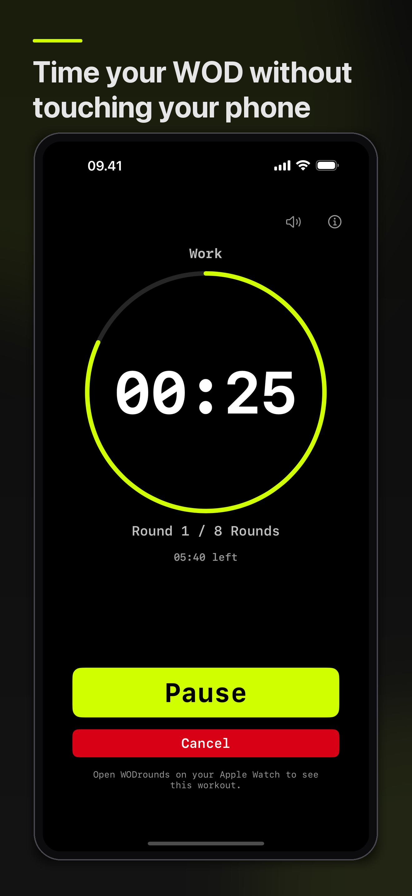
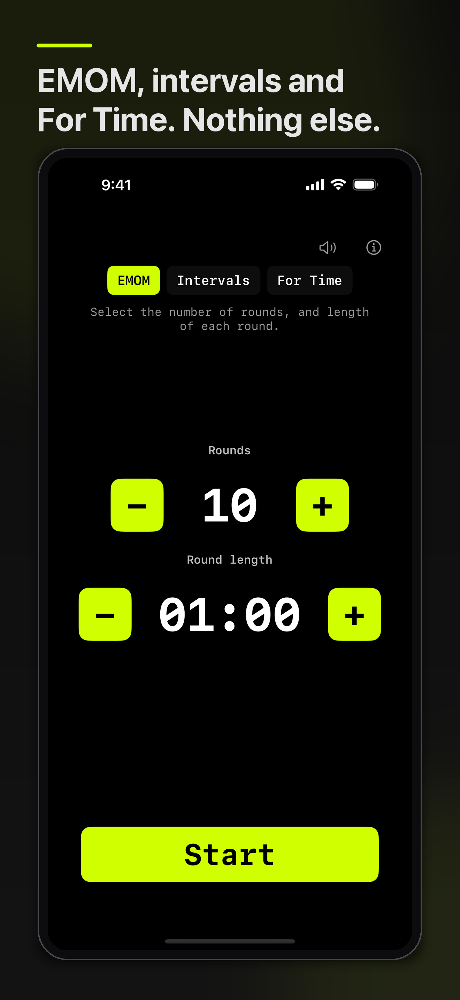

# WODrounds

EMOM & Intervals Timer

<!-- IAMJARL README store block for WODrounds (en). Generated from apps.json, v1.34.0. Do not edit. -->

  <a href="https://apps.apple.com/app/id6759229877?pt=128512007&amp;ct=github&amp;mt=8"><picture>
    <source media="(prefers-color-scheme: dark)" srcset="https://raw.githubusercontent.com/JarlLyng/iamjarl-design/v1.34.0/badges/app-store-white-en-us.svg">
    
  </picture></a>
   
  $2.99 once · iOS 16 or later · <a href="https://wodrounds.iamjarl.com">wodrounds.iamjarl.com</a>

  
  

WODrounds times EMOM, intervals and For Time, in numbers you can read from across the room. A voice calls get ready, halfway and the last ten seconds, and your Apple Watch follows the workout you started on your phone. One purchase covers iPhone, iPad, Apple Watch, Mac and Apple TV, with no account, no ads and no subscription.

## For developers

  <a href="https://madebyhuman.iamjarl.com"><picture>
    <source media="(prefers-color-scheme: dark)" srcset="https://madebyhuman.iamjarl.com/badges/co-created-white.svg">
    </picture></a>
  
  

The developer half: how to build and run the app, how it is put together, how to contribute, and the license.

### Build and run

- **Xcode:** open `WODrounds.xcodeproj` and pick the scheme **WODrounds** (iOS, iPadOS, macOS, tvOS) or **WODrounds Watch** (watchOS). Build and run on a simulator or a device.
- **iPhone and Watch:** run the main app on an iPhone (or "Any iOS Device"). The Watch app is embedded and installs with it.
- **Crash reporting (optional):** copy `Sentry.xcconfig.example` to `Sentry.xcconfig` and add a DSN. The build works without it. See [docs/SENTRY.md](docs/SENTRY.md).
- **Tests:** `WODroundsTests` uses Swift Testing. Run them with **Product → Test** or `⌘U`.
- **Docs:** run `python3 scripts/validate_docs.py` before committing changes to `docs/`. CI runs it too ([`docs.yml`](.github/workflows/docs.yml)). It checks image references, App Store URLs, JSON-LD, the sitemap and canonical URLs.
- **Releasing:** Xcode Cloud builds every platform when the `release` branch moves (`git push origin main:release`). Pushes to `main` never build. The runbook is [docs/RELEASING.md](docs/RELEASING.md).

### Architecture

What each mode does, with its ranges and the in-app flow, is in [docs/MODES.md](docs/MODES.md).

**Principles:** an ultra-minimal UI, large type, one-handed use, Date-based timing (reliable when backgrounded), the native Apple stack, and **start on iPhone, follow on Watch** (one workout, one synced state).

#### Targets

- **WODrounds:** the main app for iOS, iPadOS, macOS and tvOS. One target, several destinations.
- **WODrounds Watch:** the embedded Watch app (watchOS). A separate target, bundled inside the iOS app for distribution.

#### Main app (WODrounds)

- **Shared/WODTimerEngine.swift:** shared with the Watch target. The state machine for EMOM, Intervals and For Time; Date-based and deterministic, with no UI, sound or haptics. `effectiveWorkoutEndDate(now:)` gives HealthKit the active time.
- **WODTimerSync.swift:** sends the timer state to the Watch over WatchConnectivity.
- **DesignTokens.swift:** re-exports the IAMJARL design tokens from the SPM package and adds app-specific font sizes.
- **ContentView.swift:** shared types (ranges, the `TimerUIMode` enum) used by every platform view.
- **iOSContentView.swift:** the iOS and iPadOS UI: HealthKit, haptics, sounds, the count-in, the idle timer.
- **macOSContentView.swift:** the macOS UI: a compact window (340×560) and a flash overlay.
- **tvOSContentView.swift:** the tvOS UI: focus-based navigation, `.buttonStyle(.card)`, large type, sounds.
- **SharedTimerViews.swift:** shared UI components (stepper, primary button, done view and so on).
- **WorkoutSoundManager.swift:** sound cues on iOS and tvOS: the count-in start, the halfway and ten-seconds voice cues, a 3-2-1 countdown, rounds-remaining announcements (10, 5, 2) and a randomized completion line. The lines are in [docs/VOICE_CUES.md](docs/VOICE_CUES.md).
- **HealthKitWorkout.swift:** saves completed workouts to Apple Health as HIIT sessions (iOS and iPadOS only).
- **WODroundsApp.swift:** the app entry, `WindowGroup { ContentView() }`.

**The engine:**

- Platform-agnostic (Foundation only).
- Date-based: elapsed = now − startDate − accumulatedPauseDuration. No frame timers.
- Actions: `start(now:)`, `pause(now:)`, `resume(now:)`, `reset()`, `tick(now:)`, `finish(now:)` (For Time's Stop, which freezes the final time).
- Snapshot: state, remainingTime, elapsedTime (the count-up headline for For Time), currentRound, currentPhase (work or rest), remainingTimeInPhase, secondsIntoCurrentMinute (EMOM).
- For Time: `forTime(capSeconds: Int?)`. `nil` is uncapped (no total, never finishes on its own); otherwise it finishes at the cap.

#### Watch app (WODrounds Watch)

In `WODroundsWatch/`:

- **WODroundsWatchApp.swift:** the Watch app entry (`@main`).
- **WatchContentView.swift:** the timer UI. It reads the synced state from WatchConnectivity while the iPhone runs a workout, and runs a local timer otherwise.
- **WatchDesign.swift:** imports the colors from the IAMJARL package, with Watch-scaled spacing and type.
- **Shared/:** WODTimerEngine, shared with the main app for workouts run on the Watch alone.
- **WODTimerSync.swift:** receives the synced state from the iPhone over WatchConnectivity.
- **WatchSessionManager.swift:** an `ObservableObject` and `WCSessionDelegate` that decodes the payload from `didReceiveApplicationContext`.

**iPhone to Watch sync:**

- `WCSession.updateApplicationContext`, iPhone to Watch. No App Group needed.
- The iPhone sends the state (startDate, pause, mode, rounds) on every action and every second while running, so the Watch shows the same remaining time and round.
- With no synced state, the Watch runs its own local timer.

**Apple Health (iOS and iPadOS):**

- The HealthKit capability and its usage strings are in Info.plist.
- An HK workout (HIIT) starts when the timer starts, after the count-in, and ends on Finish, Reset or Cancel. Duration is the active time, with pauses left out. Authorization is asked for on the first Start.

#### Design system (IAMJARL)

The app follows the IAMJARL design system through its SPM package, [iamjarl-design](https://github.com/JarlLyng/iamjarl-design). No hardcoded colors, spacing, radius or typography in the UI.

- Design rules: https://jarllyng.github.io/iamjarl-design/design.md
- Tokens (JSON): https://jarllyng.github.io/iamjarl-design/tokens.json
- SPM package: `https://github.com/jarllyng/iamjarl-design.git`, added to both the WODrounds and the Watch target.

`DesignTokens.swift` re-exports the package with `@_exported import` and adds app-specific font sizes. `WatchDesign.swift` imports the colors from the package and defines Watch-scaled spacing and type.

The look: heavy whitespace, large monospaced numbers, a clear hierarchy, minimal color, dark first. The primary color for main actions, the error color for destructive ones (Cancel). Buttons are solid and tactile, and the timer owns the screen.

#### Localization

English, Danish and Spanish (es-MX). The UI is localized. The spoken cues stay English in every language, because they are recorded voice files rather than synthesized text.

#### Marketing site

A static site lives in `docs/` and is served by GitHub Pages at **[wodrounds.iamjarl.com](https://wodrounds.iamjarl.com)** (Settings → Pages → Deploy from branch → `main`, `/docs`). It has the home page, a page per timer, the Apple Watch page, workout examples, a guide, privacy and support, with translated pages in their own folders.

The site counts aggregate page views with [Umami](https://umami.is/). The app has no marketing analytics; iOS uses Sentry for crashes only, as [PrivacyPolicy.md](PrivacyPolicy.md) says. For search, the pages carry canonical URLs, Open Graph, Twitter Cards, JSON-LD and a sitemap.

### Contributing

Read [CONTRIBUTING.md](CONTRIBUTING.md) first. Bugs, feature requests and tasks are [GitHub Issues](https://github.com/JarlLyng/WODrounds/issues) on this repo; do not add task-tracking `.md` files. Security issues go through [SECURITY.md](SECURITY.md), and the [Code of Conduct](CODE_OF_CONDUCT.md) applies.

The rules for code:

- Keep logic deterministic and explicit, with simple state machines.
- Avoid overengineering and third-party libraries.
- SwiftUI only. Deployment targets are set per platform in the project.
- Drive timer updates from Date (e.g. `TimelineView(.periodic(from:by:))` with `snapshot(now:)` / `tick(now:)`).
- New features stay simple, clear and free of UI noise. When in doubt, choose the simpler solution.

Live Activities and the Dynamic Island, an Apple Watch complication and a presets library have been considered. Do not let them drive the current architecture.

#### Documentation

| File | What it covers |
|------|----------------|
| [docs/MODES.md](docs/MODES.md) | The timer modes, their ranges and the in-app flow |
| [docs/VOICE_CUES.md](docs/VOICE_CUES.md) | The spoken cues: their lines, when they play, how they are recorded |
| [docs/ARCHIVE.md](docs/ARCHIVE.md) | Archive destinations, platform filtering, entitlements |
| [docs/APP_ICONS.md](docs/APP_ICONS.md) | The icon asset checklist for every platform |
| [docs/APP_STORE_CONNECT.md](docs/APP_STORE_CONNECT.md) | App Store text (subtitle, description, keywords) for iOS, Mac and tvOS |
| [docs/RELEASING.md](docs/RELEASING.md) | The release runbook: Xcode Cloud, version bumps, App Store submission |
| [docs/SENTRY.md](docs/SENTRY.md) | Crash reporting setup (iOS only) |
| [PrivacyPolicy.md](PrivacyPolicy.md) | The privacy policy for the App Store and the app. **Keep it in sync** with `docs/privacy.html` |
| [Support.md](Support.md) | Support copy for the App Store and the app. **Keep it in sync** with `docs/support.html` |
| [CHANGELOG.md](CHANGELOG.md) | User-facing changes, newest first |

### License

[MIT](LICENSE). WODrounds is made by Jarl at [IAMJARL](https://iamjarl.com).
